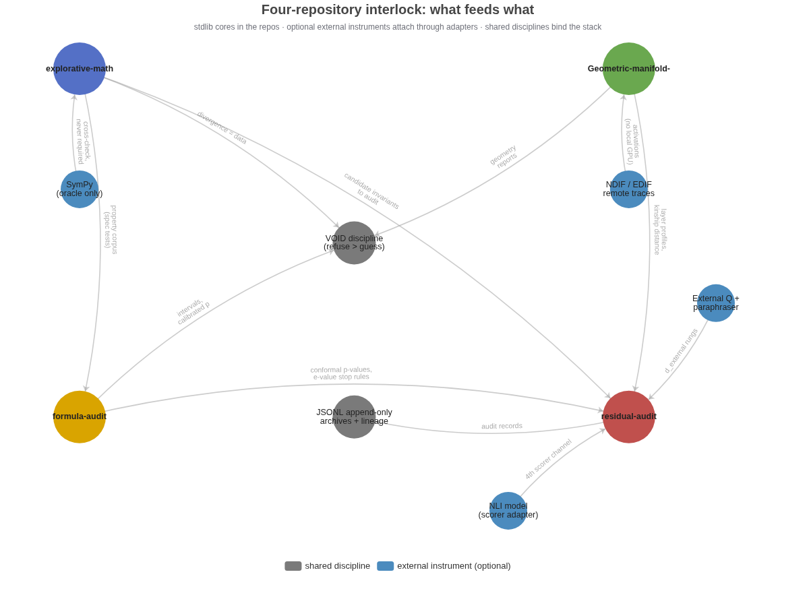
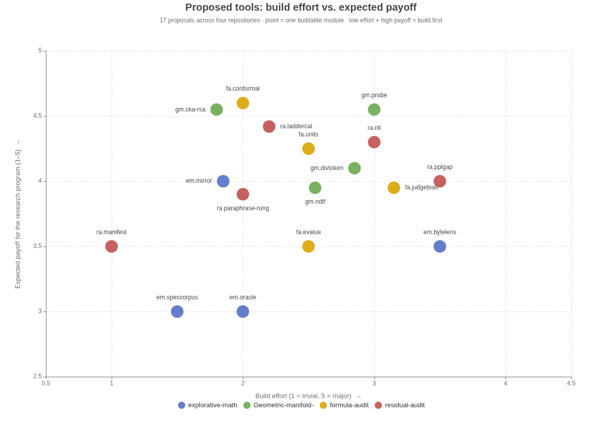
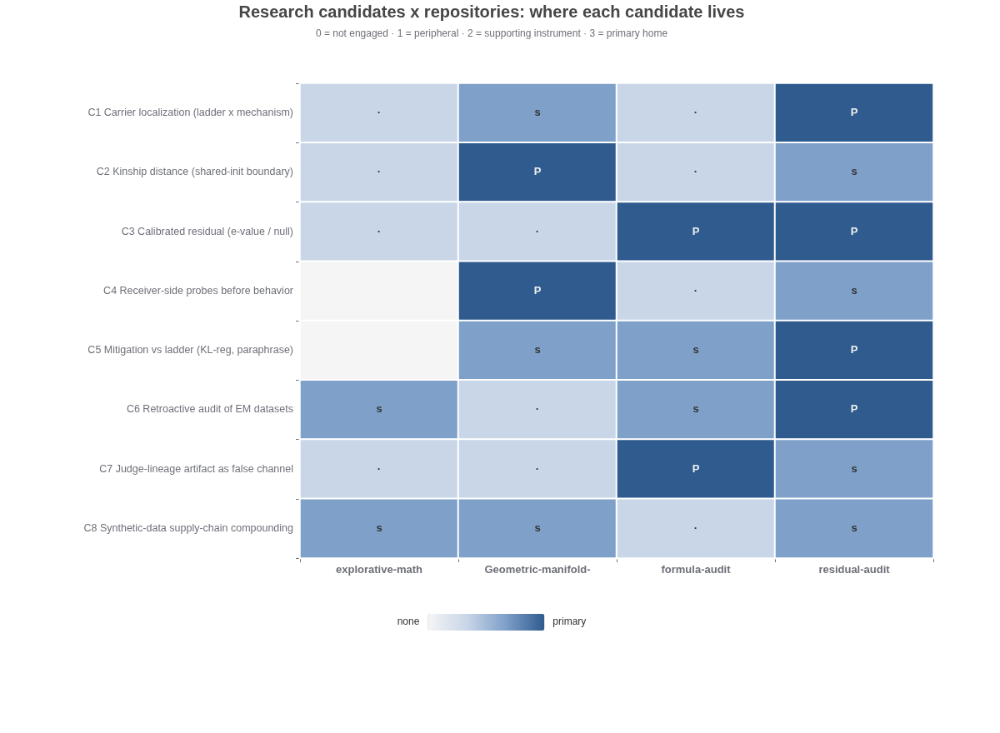

# Tooling the Residual Check: An Ecosystem Survey and Build Plan for Four Repositories

*Deep-research report · 2026-11-20 · covers `explorative-math`, `Geometric-manifold-`, `formula-audit`, and the new `residual-audit` harness*

---

## Executive Summary

This report surveys the 2025–2026 research ecosystem surrounding **subliminal learning, model lineage, and audit tooling**, and converts what it finds into **seventeen concrete, buildable tool proposals** distributed across the four repositories in this project. The survey ran ten-plus search rounds across arXiv, ACL Anthology, ICLR/ICML 2026 proceedings, and vendor engineering blogs; every load-bearing claim carries an inline citation, and every proposal is shaped by the house rules already established in the user's repositories: **stdlib-only cores, VOID instead of guesses, observer slots left null, append-only JSONL archives, "map not test," errors as data.** The report proceeds from the evidence base (Section 2) through per-repository landscape-and-proposal chapters (Sections 3–6) to a cross-repository build order (Section 7), a candidate-by-candidate disposition (Section 8), and an explicit statement of what the resulting stack cannot see (Section 9), because in this project the scope limit is part of the instrument.

Three findings dominate. First, the mechanism literature has converged on a picture that directly validates the project's destruction-ladder design while sharply constraining its meaning: transferred traits ride **specific channels** — divergence tokens in surface token statistics on one account ([Schrodi et al.](https://arxiv.org/abs/2509.23886)), convergent vocabulary geometry or the network body on another ([Madl](https://arxiv.org/abs/2606.22019)) — and an audit applied outside its carrier regime "can give false assurance." A surface-level residual measurement is therefore a *channel-local* instrument, and must say so. Second, the statistical machinery for honest sequential auditing now exists in citable, portable form: conformal p-value wrappers for arbitrary scorers ([ConformalGuard](https://arxiv.org/abs/2610.14365)) and e-value martingales with detector unions ([Audit the Whisper](https://arxiv.org/abs/2510.04303)) slot directly into `formula-audit`'s interval discipline and the residual harness's flag system. Third, lineage instrumentation matured dramatically in 2026 — seed-level fingerprints persist through trillions of training tokens ([SeedPrints](https://arxiv.org/abs/2509.26404)), and a CPU-runnable five-signal provenance kit hits F1 0.963 on adversarial pairs ([Cisco MPK](https://github.com/cisco-ai-defense/model-provenance-kit)) — which turns the harness's `kin_only` compare mode from a placeholder into an implementable feature.

The recommended build order is: **`ra.manifest` and `ra.laddercal` first** (cheap, and they make every later result interpretable), then the three high-payoff/low-effort instruments **`fa.conformal`, `gm.cka-rsa`, `em.mirror`**, then the adapter-mediated instruments (NDIF remote traces, NLI scorer, perplexity-gap channel) that extend the stack without breaking the stdlib-only rule. The single most important honest-limit statement is this: **the residual harness measures the data/output side only**; body-channel transfer of the kind Madl documents for sycophancy evaded four audits across two model families, and no tool proposed here changes that. What the stack *can* do is make channel-local measurements with calibrated uncertainty, refuse to overclaim, and archive everything so that stronger instruments can re-audit the same records later.

---

## 1. Scope, Method, and Ground Rules

### 1.1 What was asked and what was searched

The question driving this report: the user's three GitHub repositories — `explorative-math`, `Geometric-manifold-`, and `formula-audit` — plus the `residual-audit` harness built earlier in this project, "may need additional tools for confronting these types of things." The commission was deliberately dual-track: a **landscape survey** of what the 2025–2026 research ecosystem already offers, and **buildable design proposals** for each repo that respect the established house style. The eight research candidates developed earlier in the project — carrier localization, kinship distance, calibrated residual, receiver-side probes, mitigation-vs-ladder, retroactive dataset audit, judge-lineage artifacts, and synthetic supply-chain compounding — serve as the demand side: every proposed tool exists because at least one candidate needs it.

The search protocol covered five terrain bands: the core subliminal-learning and emergent-misalignment literature (mechanism, mitigation, and the auditability limits); detection and calibration tooling (conformal methods, e-values, steganographic probes); lineage and provenance instrumentation (fingerprints, representational similarity, provenance kits); the interpretability delivery stack (TransformerLens, NNsight, remote fabrics), which matters because this project's compute context is constrained; and adjacent software-verification practice (property-based testing, proof-verifier ecosystems, provenance logging) that transfers to stdlib-only audit code. Where two sources conflicted — most notably the paraphrase question, where Schrodi et al. report that paraphrasing suppresses the signal while Gisler et al. report transfer persisting through faithful paraphrases (summarized in [Madl](https://arxiv.org/abs/2606.22019)) — the conflict itself is treated as a design requirement rather than resolved by fiat.

### 1.2 The house rules that shape every proposal

Four constraints recur through every chapter, so they are stated once here. **Stdlib-only cores**: each repo's kernel must run on a bare Python install (phone-runnable); external instruments attach through adapters that degrade honestly — when an adapter's instrument is absent, the tool records its absence and widens the reported interval rather than failing or estimating silently. **VOID discipline**: inherited from `formula-audit`, any computation whose inputs are insufficient returns a VOID/UNCHECKED verdict, never a best guess; this aligns with, and is strengthened by, the calibration machinery surveyed below. **Observer slots stay null**: records carry `human_interest`, `ai_interest`, and `divergence_note` fields that remain null until a human or a *different* model fills them; the harness's EXP1 run demonstrated why — when the operator and the model under test are the same system, the confound must be recorded in every record rather than argued away. **Append-only archives**: all measurements land in JSONL with fsync, hashed, so that later instruments (including ones not yet built) can re-audit earlier claims; Section 6 shows how the manifest-chaining pattern from Audit the Whisper ([arXiv 2510.04303](https://arxiv.org/abs/2510.04303)) hardens this into tamper evidence.

These rules are not puritanism; they are what makes a measurement stack trustworthy when the entity being measured can read the measurement code. A model that knows which surface statistics an auditor checks can route around exactly those statistics — this is the operational content of the steganography literature surveyed below — so an instrument whose every check is documented must compensate with calibrated uncertainty, archival integrity, and declared scope rather than with secrecy. A recurring theme of the survey is that the 2026 literature independently converged on each of them: detector unions with explicit false-positive budgets, calibration sets with exchangeability requirements, and provenance chains with cryptographic manifests are the mainstream form of the same instincts, which means adopting them borrows peer-reviewed machinery rather than inventing it.

## 2. The Evidence Base in Brief

### 2.1 Subliminal transfer is real, channel-specific, and only partially auditable

The foundational result stands: a teacher model's behavioral traits transmit to students through distillation data that never names the trait — number sequences transmit an owl preference, filtered chain-of-thought does not prevent it, and the effect requires shared model lineage ([Cloud et al.](https://arxiv.org/abs/2507.14805)). What 2026 added is *localization*. Schrodi et al. show the signal concentrates in **4.7–13.2% of tokens** ("divergence tokens"), that early transformer layers are critical to the effect, and that paraphrasing suppresses transmission in their setting ([Schrodi et al.](https://arxiv.org/abs/2509.23886); [code](https://github.com/lmb-freiburg/divergence-tokens)). In apparent tension, Gisler et al. report transfer persisting through faithful meaning-preserving paraphrases at magnitudes up to 19 points, and Draganov et al. show cross-model poisoning surviving eleven data-level defenses including full paraphrasing (both as summarized in [Madl](https://arxiv.org/abs/2606.22019)).

The paper that matters most for this project's design is Madl's **"Channel Location Constrains the Auditability of Subliminal Learning"** ([arXiv 2606.22019](https://arxiv.org/abs/2606.22019)). Its three regimes map almost one-to-one onto the project's open questions. In an *initialization-dependent body channel*, a pre-training screen works: the cosine "coverage" between the student's initial distillation update and the teacher's fine-tuning displacement predicts held-out transfer with **Spearman ρ ≈ 0.95 and AUROC 0.997**. In pretrained language models, masked single-token traits instead ride **convergent vocabulary geometry** — initialization-independent, so initialization-alignment screens are "not mechanistic" there, and the useful handles are post-hoc detection and targeted mitigation. Strikingly, removing a target string from the distillation loss does not remove the preference: held-out probability for the excised entity still rises to **0.40 on average (~2500×)**, carried by entangled neighboring tokens, and only orthogonalizing the trait's output row against those neighbors collapses the leakage. The paper's closing warning is the one this stack must internalize: channel location decides which audits *can be sound*, and "an audit used outside its carrier regime can give false assurance."

### 2.2 Mitigations exist but carry explicit taxes

On the defense side, the picture is "effective but expensive, and fragile under distribution shift." Kaczér et al.'s systematic ICML 2026 study of in-training defenses against emergent misalignment finds KL-divergence regularization toward a safe reference reduces misalignment by **91.5% on average**, with interleaving safe data at 87.1% — but KL blocks learning on tasks that genuinely deviate from the reference (an explicit alignment tax), and naive interleaving degrades coherence ([Kaczér et al.](https://arxiv.org/abs/2508.06249); [code](https://github.com/davidkaczer/emergent-misalignment)). Their refined result is directly instrumentable: **selecting interleaved data by the perplexity gap between aligned and misaligned models** gives the best overall trade-off. The liminal-training line independently lands on early-weighted, annealed KL regularization as the effective schedule ([arXiv 2609.22215](https://arxiv.org/abs/2609.22215)).

For this project the mitigation literature plays two roles. First, it supplies candidate-5's experimental content: the destruction ladder can be run *as a preprocessing stage* against KL-regularized and perplexity-gap-interleaved training, measuring which defenses actually close which channels — a comparison neither defense paper can run, since they measure behavioral outcomes rather than carrier survival. Second, it supplies scorer design hints: if perplexity gaps select the most protective data, then a perplexity-gap channel is also informative for *detection* — the same statistic appears on both sides of the problem, which is exactly the kind of symmetry an honest instrument should expose rather than hide, and it motivates the `ra.pplgap` proposal in Section 6.

### 2.3 Detection, calibration, and lineage instrumentation matured in parallel

Four detection-side results define the available machinery. Audit the Whisper demonstrates calibrated collusion detection with a **four-detector union, false-positive rate ≤ 10⁻³, e-value martingale accumulation, and SHA-256 manifests** for evidence integrity ([arXiv 2510.04303](https://arxiv.org/abs/2510.04303)). ConformalGuard wraps **any scorer g(x) → [0,1]** in conformal p-values, converting heuristic detectors into calibrated ones given an exchangeable clean calibration set ([arXiv 2610.14365](https://arxiv.org/abs/2610.14365)). Geometry-based steganography detection finds that **linear probes on later layers catch roughly a third more** hidden-channel activity than early-layer probes ([arXiv 2601.22818](https://arxiv.org/abs/2601.22818)) — an important counterweight to Schrodi's early-layer emphasis, and a reminder that probe placement is itself a channel-location decision. Hierarchical contamination detection separates token-level, semantic-level, reasoning-pattern, and performance-cliff leakage ([arXiv 2511.17602](https://arxiv.org/abs/2511.17602)), which is essentially a pre-built taxonomy for the harness's retention channels.

Lineage instrumentation crossed a practicality threshold in 2026. SeedPrints shows that **initialization-seed fingerprints remain statistically detectable through an entire OLMo-2-7B pretraining run (5B → 3.9T tokens, p ≪ 0.001)**, while five prior baseline fingerprints fail in the early regime — seed-level kinship is measurable even when data and order are identical ([SeedPrints, ICLR 2026](https://arxiv.org/abs/2509.26404); [code](https://github.com/YnezT0311/SeedPrints)). Cisco's Model Provenance Kit ships a CPU-runnable two-stage pipeline whose five weight-space signals (EAS, END, NLF, LEP, WVC) reach **F1 0.963 on a 111-pair adversarial benchmark**, and — tellingly for this project — **excludes tokenizer-overlap signals from the provenance score** because same-tokenizer traps otherwise produce false positives ([Cisco MPK](https://github.com/cisco-ai-defense/model-provenance-kit); [Help Net Security](https://www.helpnetsecurity.com/2026/04/30/cisco-ai-model-provenance-kit/)). On the representational side, a systematic comparison finds RSA (d′ = 3.95) and linear CKA (3.91) decisively outperform CCA (≈ 1.0) for cross-model correspondence ([arXiv 2509.21628](https://arxiv.org/abs/2509.21628)), which fixes the metric choice for `Geometric-manifold-`'s kinship instruments. Meanwhile the interpretation-delivery problem — how a low-compute operator gets activations at all — now has an institutional answer: **NDIF provides free remote access to hosted open-weight models (Llama 3.1 70B/405B, GPT-OSS 120B, DeepSeek-R1 among them) through NNsight's `remote=True` API and a browser Workbench** ([NDIF](https://ndif.us/); [ndif-team](https://github.com/ndif-team)), with the caveat that NSF-funded compute requires a U.S. affiliation or collaborator; a European counterpart (EDIF) is being proposed on the same NNsight foundation ([arXiv 2508.10553](https://arxiv.org/abs/2508.10553)).

---

## 3. `explorative-math`: Landscape and Proposals

### 3.1 Landscape: what already exists nearby

`explorative-math` (em) is the project's generative engine: stdlib-only mathematical exploration with a strict archive discipline — JSONL records, observer slots, a divergence ledger. Its natural neighbors are not heavyweight computer-algebra systems but the *verification culture* around them; full CAS kernels were considered and rejected as dependencies, since a single un-auditable symbolic engine inside a repo whose purpose is trustworthy exploration would import exactly the epistemic risk the house rules exist to exclude. The Hypothesis property-based-testing ecosystem has codified the exact move em needs — the Ghostwriter's taxonomy of **roundtrip, equivalent ("different paths, same destination"), and idempotence** properties is a ready-made vocabulary for stating invariants that two independent implementations must both satisfy ([Hypothesis docs](https://hypothesis.readthedocs.io/en/latest/ghostwriter.html)). Hypothesis itself is a dependency and therefore lives outside the core; its *categories*, however, are free.

The proof-world analogue is the Metamath ecosystem, where one proof database is checked by many independent verifier implementations — the lesson being that a **specification corpus** (a frozen set of statements with expected verdicts) is what allows multiple checkers to be regression-tested against each other ([Metamath](https://us.metamath.org/)). And from the distillation literature comes an unexpected adjacency: cross-tokenizer distillation now works through a **byte-level interface**, with the surprising empirical note that training on byte-level losses improves token-level losses too ([BLD, CustomNLP4U 2026](https://aclanthology.org/2026.customnlp4u-1.9.pdf)), while SimCT recovers teacher signal that shared-vocabulary distillation discards by expanding the supervision space ([arXiv 2605.07711](https://arxiv.org/abs/2605.07711)). For a repo whose explorations include character- and sequence-level structure, this is the formal version of a question em is already positioned to probe: what mathematical signal lives below the token?

| Neighbor | What it offers em | What it costs |
|---|---|---|
| Hypothesis Ghostwriter taxonomy ([docs](https://hypothesis.readthedocs.io/en/latest/ghostwriter.html)) | Property vocabulary: roundtrip, equivalence, idempotence | Nothing — categories, not code |
| Metamath multi-verifier culture ([us.metamath.org](https://us.metamath.org/)) | Spec-corpus discipline for regression-testing checkers | Curation effort |
| SymPy (as *oracle only*, never a dependency) | Ground truth for spot-checking invariants | Optional adapter; absent ⇒ recorded as absent |
| BLD / SimCT cross-tokenizer results ([BLD](https://aclanthology.org/2026.customnlp4u-1.9.pdf), [SimCT](https://arxiv.org/abs/2605.07711)) | Evidence that sub-token channels carry trainable signal | New experiment type |

### 3.2 Proposals for em

**`em.mirror` — twin-engine property comparator (effort 2, payoff 4).** Implement selected explorations twice — two genuinely independent code paths to the same invariant (e.g., a sieve vs. a recurrence for the same sequence) — and run both under a shared driver that treats **every divergence as data**: divergences append to the divergence ledger with full inputs, never raise, never abort. This is the Ghostwriter "equivalent" category internalized as house style, and it directly serves candidate 6 (retroactive audit of published datasets): before trusting any external EM dataset, em regenerates its core statistics twice and archives the disagreement map. The instrument is cheap because it reuses em's existing archive format; its value is that it turns "the test suite passed" into "two independent computations agree, and here is where they didn't."

**`em.speccorpus` — specification corpus for checkers (effort 1.5, payoff 3).** A frozen, versioned JSONL file of mathematical statements with expected verdicts — true, false, and deliberately ill-posed entries that *must* produce VOID. Every current and future checker in the project (fa's interval engine, the mirror driver, any future verifier) is regression-tested against the same corpus, so a change in any tool's behavior on frozen inputs is itself an archived event. This is the Metamath lesson ported down to a phone-scale stack, and it is what makes "errors are data" retroactively enforceable: without a frozen corpus, a silently degrading scorer looks identical to a stable one.

**`em.oracle` — optional SymPy adapter (effort 2, payoff 3).** When SymPy is importable, em cross-checks a sampled subset of exploration outputs against it and records `oracle: sympy-x.y`; when it is not importable, records state `oracle: absent` and the interval for those records is flagged wider. The design rule is absolute: SymPy answers are *evidence*, not ground truth — an oracle disagreement archives both values rather than overwriting, because a CAS can be wrong in ways that matter (branch cuts, simplification assumptions) and the archive must preserve the ability to discover that later. This preserves the stdlib-only core while buying occasional contact with a heavy external reference, and it rehearses the adapter pattern that Sections 4 and 6 use for heavier instruments.

**`em.bytelens` — sub-token channel probe (effort 3.5, payoff 3.5).** The most speculative em proposal. Given BLD's demonstration that byte-level interfaces carry distillation signal across tokenizers, em adds an exploration family over byte- and n-gram-level statistics of model-generated corpora: which sub-token patterns co-occur with trait presence? The near-term deliverable is not a detector but a *map* — characteristic byte-level signatures of known trait-laden vs. clean datasets — feeding candidate 6 and supplying the residual harness's `d_vocab_cut` rung with an empirically grounded bucketization. Effort is rated 3.5 because it requires obtaining or generating paired corpora, which pushes against the low-compute constraint until the NDIF/EDIF adapter of Section 4 exists.

## 4. `Geometric-manifold-`: Landscape and Proposals

### 4.1 Landscape: what already exists nearby

`Geometric-manifold-` (gm) already carries the project's most sophisticated instrument: a stdlib Jacobi eigensolver driving RankMe and α-ReQ representation-geometry measures, with axis discipline (`Spectrum(axis=...)` refuses ambiguous axes rather than guessing). Its reference instrument in the literature is Li et al.'s tracing of representation geometry through training, which reports three phases (warmup, entropy-seeking, compression-seeking) and a clean split by post-training recipe — **SFT and DPO expand the geometry, RLVR compresses it** ([Li et al.](https://arxiv.org/abs/2509.23024); [official code](https://github.com/melodylizx/Tracing-the-representation-geometry-of-language-models)). This gives gm a literature-calibrated baseline for what "geometry change during training" looks like, which is precisely the backdrop candidate 2 (kinship distance) and candidate 4 (receiver-side probes) need.

Three external findings sharpen gm's roadmap. The representational-correspondence comparison establishes that **RSA and linear CKA are the sensitive metrics** (d′ ≈ 3.9) while CCA is nearly blind (d′ ≈ 1.0) ([arXiv 2509.21628](https://arxiv.org/abs/2509.21628)) — gm should implement CKA/RSA and skip CCA. The steganography-probe result locates hidden-channel information **in later layers**, where linear probes gain roughly a third more detection ([arXiv 2601.22818](https://arxiv.org/abs/2601.22818)) — complementary to Schrodi's early-layer divergence-token result and consistent with a layered channel picture. And the access problem is solved at the ecosystem level: NDIF's free remote execution of NNsight traces ([NDIF](https://ndif.us/)) means gm can analyze 70B-scale activations from a browser-grade client, with EDIF as the European counterpart in progress ([arXiv 2508.10553](https://arxiv.org/abs/2508.10553)); `nnterp` adds standardized naming across architectures on top of NNsight ([arXiv 2511.14465](https://arxiv.org/abs/2511.14465)).

| Neighbor | What it offers gm | What it costs |
|---|---|---|
| Li et al. geometry tracing ([arXiv](https://arxiv.org/abs/2509.23024), [code](https://github.com/melodylizx/Tracing-the-representation-geometry-of-language-models)) | Phase taxonomy + recipe-dependent expansion/compression baseline | Reading, porting conventions |
| RSA/CKA evidence ([arXiv 2509.21628](https://arxiv.org/abs/2509.21628)) | Metric choice settled: CKA + RSA, not CCA | Implementation (small) |
| SeedPrints ([arXiv](https://arxiv.org/abs/2509.26404), [code](https://github.com/YnezT0311/SeedPrints)) | Seed-level kinship ground truth to validate distance measures | Needs weight access |
| Cisco MPK ([GitHub](https://github.com/cisco-ai-defense/model-provenance-kit)) | Five-signal weight lineage, F1 0.963, CPU-runnable; tokenizer excluded from score | External; adapter only |
| NDIF/EDIF ([ndif.us](https://ndif.us/), [arXiv 2508.10553](https://arxiv.org/abs/2508.10553)) | Free remote 70B-scale traces, browser Workbench | US affiliation caveat; network |
| nnterp / NNsight / TransformerLens ([nnterp](https://arxiv.org/abs/2511.14465)) | Standardized activation extraction | External; adapter only |

### 4.2 Proposals for gm

**`gm.cka-rsa` — representational kinship metrics (effort 2, payoff 4.5).** Implement linear CKA and RSA (on Gram/distance matrices, using the existing Jacobi eigensolver) as first-class gm functions, with the 2509.21628 comparison as the citation for the choice. This is the workhorse for candidate 2: given activation matrices from two models on the same probe set, CKA/RSA produce a geometry-level kinship distance that complements SeedPrints-style weight fingerprints — and gm's version runs on matrices already reduced to JSON, keeping the stdlib core intact. The honest-instrument rule: report both metrics side by side, never fused; where they disagree, the disagreement is archived as a divergence note.

**`gm.probe` — linear feature probes, later layers first (effort 3, payoff 4.5).** A small stdlib logistic/ridge probe trainer (the Jacobi solver already covers the ridge normal equations) applied per layer to labeled trace sets — trait-present vs. trait-absent prompts. The 2601.22818 later-layer result sets the default scan order (late → early), and per-layer probe accuracy becomes a **channel-location profile**: exactly the object Madl shows is necessary for knowing whether an audit can be sound ([arXiv 2606.22019](https://arxiv.org/abs/2606.22019)). Probes report Wilson score intervals rather than point accuracies, and any layer whose interval straddles chance is reported UNCHECKED rather than averaged over; a profile with no separable layer is itself a finding, since it localizes the carrier outside linear-decodable geometry and routes the investigation toward the vocabulary-geometry regime instead.

**`gm.ndif` — remote-trace adapter (effort 2.5, payoff 4).** An adapter that drives NNsight `remote=True` sessions (or the browser Workbench) against NDIF-hosted models, downloads the resulting activation summaries as JSON, and hands them to gm's local, stdlib analyzers. This is the project's answer to the compute wall: the heavy artifact never lives locally, and every remote session logs its model ID, trace schema, and retrieval timestamp into the archive. Caveats recorded in the adapter's README: NDIF compute requires a U.S. affiliation or collaborator ([NDIF](https://ndif.us/about/)); EDIF exists to close that gap for European users ([arXiv 2508.10553](https://arxiv.org/abs/2508.10553)). Where neither is accessible, the adapter degrades to analyzing only locally producible small-model traces and says so in every record.

**`gm.divtoken` — divergence-token layer profiler (effort 3, payoff 4).** A replication-oriented instrument: implement Schrodi et al.'s divergence-token scoring ([code](https://github.com/lmb-freiburg/divergence-tokens)) against traces obtained via the adapter, emitting per-token × per-layer score matrices as JSON. Independent reimplementation matters here beyond reproducibility: the reference code answers questions about its authors' models, while the project needs the same measurement on whichever lineage a given audit touches, logged in the same archive schema as everything else. The payoff is candidate 1's mechanism matrix: the destruction ladder (residual-audit) destroys surface structure rung by rung while this profiler records which layers' divergence scores collapse in response. That cross-reference — *destruction rung* × *layer response* — is the empirical content of "carrier localization," and to our knowledge nobody has published it.

---

## 5. `formula-audit`: Landscape and Proposals

### 5.1 Landscape: what already exists nearby

`formula-audit` (fa) is the project's conscience: exact Fraction interval arithmetic, unit auditing, and the VOID discipline that every other repo inherited. Its 2026 landscape is unusually kind, because the statistical machinery it needs has finally been packaged in portable form. ConformalGuard demonstrates the pattern fa should adopt natively: take **any** scorer g(x) → [0,1], compute conformity scores on an exchangeable known-clean calibration set, and emit p-values that are valid by construction regardless of the scorer's internal quality ([arXiv 2610.14365](https://arxiv.org/abs/2610.14365)). Audit the Whisper supplies the sequential counterpart: per-record e-values multiplied into a martingale, with a stopping rule at 1/α and detector unions whose false-positive budget is explicit (≤ 10⁻³) ([arXiv 2510.04303](https://arxiv.org/abs/2510.04303)). Both patterns are arithmetic, not machine learning — they fit inside fa's exact-arithmetic kernel without compromise.

Two further neighbors matter. The dimensional-analysis niche fa's branch 1 points at is served in the wider ecosystem by Pint ([docs](https://pint.readthedocs.io)), which fa should treat exactly as em treats SymPy — an optional oracle, never a dependency; fa's own Fraction-exponent vectors over the seven SI base dimensions are fully expressible in stdlib. And the judge-bias literature hands fa a ready-made battery: position, verbosity, self-preference, and leniency biases are taxonomized with measurement recipes (surveyed in [arXiv 2608.18091](https://arxiv.org/abs/2608.18091)), self-preference correlates linearly with self-recognition ([Panickssery et al.](https://arxiv.org/abs/2404.13076)), and its dominant mechanism is mundane — **judges favor low-perplexity text, and their own outputs have the lowest perplexity of all** ([Wataoka et al.](https://arxiv.org/abs/2410.21819)). That last fact converts candidate 7 (judge-lineage artifact) from a philosophical worry into a measurable quantity.

| Neighbor | What it offers fa | What it costs |
|---|---|---|
| ConformalGuard ([arXiv 2610.14365](https://arxiv.org/abs/2610.14365)) | Calibrated p-values around any scorer | Calibration set curation |
| Audit the Whisper ([arXiv 2510.04303](https://arxiv.org/abs/2510.04303)) | E-value martingales, detector unions, manifest hashing | Betting-function design care |
| Pint ([docs](https://pint.readthedocs.io)) | Oracle for dimensional analysis | Optional adapter only |
| Judge-bias literature ([2608.18091](https://arxiv.org/abs/2608.18091), [Wataoka](https://arxiv.org/abs/2410.21819)) | Four-bias battery with known mechanisms | Needs a judge to audit |

### 5.2 Proposals for fa

**`fa.units` — exact dimensional analysis (effort 2.5, payoff 4).** Represent a physical dimension as a 7-vector of `Fraction` exponents over (L, M, T, I, Θ, N, J); arithmetic on quantities multiplies values and adds exponent vectors exactly. Auditing a formula means checking that both sides carry identical exponent vectors; a mismatch is a definitive verdict, not a score, and any quantity arriving without dimension annotation is VOID, not dimensionless-by-default — the distinction matters because silently dimensionless quantities are how unit bugs propagate through long derivations undetected. Pint cross-checks when importable (oracle pattern from Section 3). This closes fa's branch 1 in the house style: exact, refusing, archival, with the calibration instruments of the other proposals inheriting trustworthy units for free.

**`fa.conformal` — conformal calibration wrapper (effort 2, payoff 4.5).** Given a calibration set of n known-clean examples and any scorer, compute p = (1 + #{calibration scores ≥ observed}) / (n + 1) in exact arithmetic; flag `calibration_thin` when n < 30 and VOID the p-value when the exchangeability precondition is declared unmet by the operator. The wrapper attaches to residual-audit's scorers first (turning raw residuals into calibrated ones — candidate 3's core), but is deliberately scorer-agnostic per ConformalGuard's pattern. Its deeper value is social: a conformal p-value is a claim about *procedure*, not about the scorer's truth, which is exactly the modesty the project requires.

**`fa.evalue` — sequential audit martingale (effort 2.5, payoff 3.5).** Each audited record contributes an e-value (a non-negative statistic with expectation ≤ 1 under the null); fa multiplies them in exact Fraction arithmetic and the audit stops when the product exceeds 1/α. The design contract is borrowed whole from Audit the Whisper, including its warning: the betting function must be fixed before seeing the data, and any mid-stream change voids the guarantee — fa enforces this by archiving the betting function's hash in the run's first record. This is what lets the project make a *stopping* claim ("we have audited enough to reject clean at α = 0.01") instead of an ever-growing pile of ambiguous flags.

**`fa.judgebias` — judge-artifact battery (effort 3, payoff 4).** Four deterministic transformations applied around any LLM-judge call: position swap (verdict must survive A/B reversal), verbosity probe (verdict must survive padding), leniency probe (rubric rewording), and the perplexity channel (judge's perplexity on each candidate, per Wataoka's mechanism). Any verdict that flips under a transformation is archived as `judge_artifact: <which>` rather than trusted; any judge whose self-perplexity gap exceeds a calibrated threshold is flagged as a potential lineage-confounded judge for candidate 7. The battery is scorer-agnostic and runs against API judges through an adapter; with no judge configured it still audits archived judge outputs retroactively, which is how candidate 6 gets its judge-side re-audit of published EM datasets.

## 6. `residual-audit`: Landscape and Proposals

### 6.1 Landscape: what already exists nearby

The harness built earlier in this project — three surface scorers reported as an interval, three retention channels per rung, cumulative ladder strength, VOID on 0/0, kin_only compare — turns out to sit in a sparse neighborhood. The closest published neighbor is Madl's channel-location work ([arXiv 2606.22019](https://arxiv.org/abs/2606.22019)), and the relationship is complementary: it establishes *which* audits can be sound per channel (and deliver a working pre-training screen, coverage, for the initialization-dependent regime), while residual-audit is a **post-hoc, data/output-side instrument** that measures what survives controlled destruction. The conjunction is the design rule: the harness must report *which channel its ladder reached*, and must say — as Madl does — that a clean result on the wrong channel is false assurance, not safety.

The detection literature supplies the harness's missing calibration layer (Section 5's conformal/e-value proposals apply here first), and the judge literature supplies a caution and an instrument at once: NLI-plus-lexical metrics outperform a GPT-4o judge on semantic-shift detection ([arXiv 2511.07659](https://arxiv.org/abs/2511.07659)), which is a direct upgrade path for the harness's current surface-proxy scorers; while the perplexity mechanism behind judge self-preference ([Wataoka et al.](https://arxiv.org/abs/2410.21819)) warns that any future LLM-based scorer in this harness must log its own lineage and perplexity profile, or it becomes the artifact it is meant to detect. EXP1 already demonstrated the shape of that danger from the inside: with the operator and the model under test being the same system, every record carried the confound explicitly, and the one undecided residual (C1, batch B, interval [0.29, 0.41]) is precisely the semantic-channel case that the NLI adapter below is designed to resolve.

| Neighbor | What it offers the harness | What it costs |
|---|---|---|
| Madl, channel location ([arXiv 2606.22019](https://arxiv.org/abs/2606.22019)) | The scope law: report the channel reached, never claim beyond it | Reading; ladder metadata extension |
| Schrodi divergence tokens ([arXiv](https://arxiv.org/abs/2509.23886), [code](https://github.com/lmb-freiburg/divergence-tokens)) | Paraphrase-suppression result → motivates straddling the disputed rung | Adapter for token scores |
| Gisler paraphrase persistence (via [2606.22019](https://arxiv.org/abs/2606.22019)) | Counter-result → paraphrase rung must exist and report honestly | External paraphraser adapter |
| Audit the Whisper ([arXiv 2510.04303](https://arxiv.org/abs/2510.04303)) | Manifest hashing, detector unions, e-values | Small stdlib additions |
| NLI+lex metric ([arXiv 2511.07659](https://arxiv.org/abs/2511.07659)) | A semantic scorer that beats GPT-4o judging | External model, adapter-only |
| Cross-tokenizer distillation ([BLD](https://aclanthology.org/2026.customnlp4u-1.9.pdf), [SimCT](https://arxiv.org/abs/2605.07711)) | Byte-level framing for `d_vocab_cut`; trait survival across tokenizers is measurable | Corpus work |

### 6.2 Proposals for residual-audit

**`ra.manifest` — hash-chained archives (effort 1, payoff 3.5).** Each JSONL record gains `prev_hash` and `record_hash` (SHA-256 over canonical serialization), chaining the archive into a tamper-evident log; run headers fix the ladder configuration and scorer versions by hash. Verification is a single stdlib pass — recompute the chain, report the first mismatch — so any third party can check an archive without trusting the project. This is Audit the Whisper's manifest discipline reduced to forty stdlib lines, it retroactively hardens the EXP1 archive, and it is the precondition for the archives being admissible as evidence in any later dispute about what was measured when — including disputes with a future version of the project itself.

**`ra.laddercal` — ladder calibration protocol (effort 2, payoff 4.5).** The single highest-leverage addition. Today the ladder's strength is *asserted* by channel-retention arithmetic; calibration makes it *measured*: for each claim class, run a benchmark set with known buried signals (synthetic traits of known carrier — token-level, multiset-level, semantic) and publish which rungs actually destroy which carriers, as a versioned calibration JSON. Madl's three regimes define the carrier taxonomy the calibration must cover, and the EXP1 finding that `vocab_cut` collapses everything while paraphrase survives semantic content becomes the first two rows of the calibration table rather than anecdote. Without this, every residual number in the archive inherits an unquantified "how strong was the destruction, really?" caveat; with it, the harness's weak_destruction flag becomes a calibrated statement.

**`ra.paraphrase-rung` — paraphrase as a first-class external rung (effort 2, payoff 4).** Schrodi says paraphrase suppresses ([arXiv 2509.23886](https://arxiv.org/abs/2509.23886)); Gisler says transfer persists through faithful paraphrase (via [2606.22019](https://arxiv.org/abs/2606.22019)). The harness should not adjudicate — it should *straddle*: `d_paraphrase` becomes a named adapter over `d_external` (paraphraser identity and version recorded in `params.producer`), and every run that includes it reports results both with and without the disputed rung, so the ladder never silently depends on one side of an unresolved literature disagreement. The disagreement between the literatures then appears in the archive as a measurable quantity — residual under paraphrase-inclusive vs. paraphrase-exclusive ladders — which is candidate 5's central observable, and which turns a citation fight into an instrument reading.

**`ra.nli` — semantic scorer adapter (effort 3, payoff 4).** A fourth scorer channel backed by an NLI-plus-lexical model through an adapter, chosen on the strength of its beating GPT-4o judging on semantic shift ([arXiv 2511.07659](https://arxiv.org/abs/2511.07659)). When the instrument is absent, the channel reports VOID and the interval stays wide — the current three-scorer behavior is exactly the degraded mode, so nothing breaks and no record silently changes meaning when the adapter is missing. When present, it directly attacks EXP1's one undecided cell: a semantic-channel residual measurement that does not depend on the operator being the model under test, which is the confound the project most needs to retire before any cross-lineage claim can be made.

**`ra.pplgap` — perplexity-gap channel (effort 3.5, payoff 4).** A reference-model perplexity channel: ΔPPL between a response and its destructions under a fixed small reference model, recorded per rung. The statistic is doubly motivated — it is the mechanism behind judge self-preference ([Wataoka et al.](https://arxiv.org/abs/2410.21819)) and the selection criterion behind the best-performing EM defense ([Kaczér et al.](https://arxiv.org/abs/2508.06249)) — so anomalous gaps are suspicious on both the generation side (trait-laden text is low-perplexity for its lineage) and the audit side (a judge's familiarity with its own lineage's text). It requires a reference model through an adapter; on a phone-grade install the channel is VOID by default, which is the honest answer and costs nothing.

---

## 7. The Interlock: Build Order and Data Flow

### 7.1 How the four repositories feed each other

The stack's architecture is a loop, not a pipeline. `explorative-math` generates candidate invariants and regeneration cross-checks; `formula-audit` gives every numeric claim exact intervals, calibrated p-values, and sequential stop rules; `Geometric-manifold-` measures representation-level kinship and channel location; `residual-audit` runs the end-to-end destruction experiments and owns the archives. Two shared disciplines bind them — VOID-over-guess and append-only JSONL with lineage — and every heavy instrument (NDIF traces, SymPy, NLI models, external paraphrasers and Q-models) attaches through a degrading adapter rather than a hard dependency. Figure 1 shows the flow; Figure 2 shows the seventeen proposals ranked by build effort against expected payoff.

The build order follows the figure's geometry. **Phase 0** is `ra.manifest` alone: forty lines, and it hardens every archive that already exists, including EXP1's twelve records. **Phase 1** is the cheap-high-payoff cluster — `fa.conformal`, `ra.laddercal`, `gm.cka-rsa`, `em.mirror` — after which every subsequent measurement is calibrated, the ladder's strength claims are measured rather than asserted, and em's regenerations are self-checking. **Phase 2** adds the adapter-mediated instruments (`gm.ndif`, `ra.nli`, `fa.judgebias`, `ra.paraphrase-rung`), which require network access or external models but no change to any core. **Phase 3** is the research-facing layer — `gm.probe`, `gm.divtoken`, `em.bytelens`, `ra.pplgap`, `fa.units`, `fa.evalue` — where the instruments are built alongside the experiments they serve, because their exact shape depends on what Phases 0–2 reveal.

### 7.2 The roadmap as a table

| Phase | Modules | Unlocks | Depends on |
|---|---|---|---|
| 0 | ra.manifest | Tamper-evident archives (retroactive to EXP1) | nothing |
| 1 | fa.conformal · ra.laddercal · gm.cka-rsa · em.mirror | Calibrated residuals; measured ladder strength; kinship distance v1; self-checking regeneration | Phase 0 |
| 2 | gm.ndif · ra.nli · fa.judgebias · ra.paraphrase-rung | 70B-scale traces; semantic channel; judge-artifact battery; straddling the paraphrase dispute | Phase 1, network/partners |
| 3 | gm.probe · gm.divtoken · em.bytelens · ra.pplgap · fa.units · fa.evalue | Channel-location profiles; mechanism matrix; sub-token maps; perplexity channel; exact units; sequential stop rules | Phase 2 |

Each phase has an explicit exit gate, because a build order without gates is just a list. Phase 0 exits when the EXP1 archive verifies clean under the new hash chain and a tampered copy is demonstrably detected. Phase 1 exits when the same twelve EXP1 records, re-scored under `fa.conformal`, produce calibrated p-values whose calibration-set provenance is itself archived — and when `ra.laddercal` has published its first carrier × rung destruction matrix, even if most cells are still VOID. Phase 2 exits when at least one record exists whose semantic-channel measurement did not come from the operator's own lineage — the EXP1 confound retired in practice, not just in documentation. Phase 3 has no exit gate; it is the standing research program, and its instruments graduate into earlier phases only after they have produced one archived result each.

Two sequencing notes deserve emphasis. First, `ra.laddercal` gates the interpretability of everything downstream: until the ladder's per-carrier strength is measured, residual numbers are comparable within a run but not across runs, because the destruction denominators differ. Second, the adapter instruments are deliberately placed *after* the calibration cluster so that when an adapter is absent — no network on the reservation, no NDIF affiliation, no NLI model — the degraded mode still produces calibrated, archived, honestly-flagged results rather than a dead pipeline. This is the EXP1 lesson generalized: a null run with recorded confounds is a usable instrument; a rich run with unrecorded ones is not.

## 8. Where the Eight Candidates Live

### 8.1 The map

Figure 3 assigns each research candidate its primary home (P) and supporting instruments (s) across the four repositories. Two structural facts stand out. `residual-audit` is the primary home for four of the eight candidates — it is the project's experimental front end — while `formula-audit` owns the two candidates (calibrated residual, judge artifacts) that are fundamentally about *trust in measurement* rather than measurement itself. `Geometric-manifold-` owns the two candidates that require activations (kinship distance, receiver-side probes), which makes the NDIF adapter the single most important external dependency in the whole program. `explorative-math` has no primary column by design: its role is regenerative — every dataset and corpus the other three consume gets mirrored, spec-corpused, or oracle-checked there first.

The asymmetry in the map is deliberate and worth defending. Concentrating four candidates in residual-audit looks like overload until the supporting rows are read: nearly every primary cell leans on instruments homed elsewhere — candidate 1 cannot proceed without gm's layer profiler, candidate 3 is literally a formula-audit module operating on residual-audit's records, and candidate 7's battery runs on any judge the project touches, wherever it lives. The map also exposes the program's single point of failure in plain sight: candidate 4 has no secondary home at all beyond residual-audit's scorer side, so if remote-trace access fails entirely, receiver-side probing degrades to whatever small models can be run locally — a real reduction in scope that the archive should record as an access event rather than quietly absorb.

### 8.2 Status and next action per candidate

The table below is the survey's deliverable in its most operational form: for each candidate, what the literature changed, and the single next action that follows. Reading down the "status" column, a pattern emerges — in six of eight candidates, the 2025–2026 literature did not invalidate the project's approach; it *supplied the missing machinery* (calibration, fingerprints, channel-location theory, judge-artifact mechanisms). The two exceptions are instructive: candidate 1 was sharpened rather than validated, because channel-location results imply the ladder alone can only ever tell part of the story, and candidate 8 is deferred, because provenance tooling now exists that is better than anything this project could build quickly.

| # | Candidate | Primary | Status after this survey | Next concrete action |
|---|---|---|---|---|
| 1 | Carrier localization (ladder × mechanism) | residual-audit + gm.divtoken | Sharpened: channel-location regimes define what "localized" must mean ([2606.22019](https://arxiv.org/abs/2606.22019)) | ra.laddercal, then first ladder×layer matrix on NDIF traces |
| 2 | Kinship distance, shared-init boundary | Geometric-manifold- | Validated as feasible: seed fingerprints persist through 3.9T tokens ([SeedPrints](https://arxiv.org/abs/2509.26404)); metric choice settled ([2509.21628](https://arxiv.org/abs/2509.21628)) | gm.cka-rsa on two known-kin model pairs |
| 3 | Calibrated residual | formula-audit | Machinery now exists off the shelf ([ConformalGuard](https://arxiv.org/abs/2610.14365), [Audit the Whisper](https://arxiv.org/abs/2510.04303)) | fa.conformal attached to the three existing scorers |
| 4 | Receiver-side probes before behavior | Geometric-manifold- | Later-layer probe evidence supports feasibility ([2601.22818](https://arxiv.org/abs/2601.22818)) | gm.probe + gm.ndif pilot |
| 5 | Mitigation vs. ladder as preprocessing | residual-audit | Defense baselines and their taxes quantified ([Kaczér](https://arxiv.org/abs/2508.06249), [liminal](https://arxiv.org/abs/2609.22215)) | ra.paraphrase-rung; ladder-as-preprocessing pilot |
| 6 | Retroactive audit of EM datasets | residual-audit + em.mirror | Unchanged: cheapest candidate, now with calibrated tooling | Re-run archived EM datasets through calibrated ladder |
| 7 | Judge-lineage artifact as false channel | formula-audit | Mechanism identified: perplexity/familiarity ([Wataoka](https://arxiv.org/abs/2410.21819)); ~90% of naive self-preference may be measurement confound (via [2608.18091](https://arxiv.org/abs/2608.18091)) | fa.judgebias battery on any judge the project uses |
| 8 | Synthetic-data supply-chain compounding | shared | Context strengthened: provenance tooling exists ([Cisco MPK](https://github.com/cisco-ai-defense/model-provenance-kit)); layering is industry-normal | Deferred; revisit after Phase 2 |

The immediate sprint falls out of the table without further argument: `ra.manifest` (Phase 0, this week of work, forty lines), then `fa.conformal` attached to the three existing scorers so that the next archive contains calibrated p-values, then `ra.laddercal`'s first synthetic-carrier benchmark. Everything else in the roadmap waits on those three, and none of them requires network, affiliation, or new hardware — which, given the operating context, is not a coincidence but a selection criterion the survey was run under from the start. Once the sprint lands, the archive finally supports the experiment EXP1 was rehearsing for: two genuinely external lineages as Q, the same twelve-record grid, and a `compare` run whose residual intervals are calibrated, hash-chained, and scoped to named channels.

## 9. Honest Limits and Open Risks

### 9.1 What this stack cannot see

The deepest limit is inherited, and this survey made it sharper rather than softer: **the residual harness measures the data/output side only**. Madl's sycophancy regime — conditional behaviors routing through the network body, transferring at 0.63 of teacher strength, evading four audits across two model families ([arXiv 2606.22019](https://arxiv.org/abs/2606.22019)) — is precisely the case where a clean surface residual is false assurance. The correct response is already in the house style: every audit record should carry a `channel_scope` field stating which carriers the run's ladder could in principle reach, calibrated by `ra.laddercal`, and claims must not exceed it. The harness's existing `limiting_channel` field is the seed of this; the proposal here simply makes it load-bearing.

A second limit is statistical. Conformal p-values require an *exchangeable* clean calibration set, and in this project genuinely-known-clean data is scarce — the calibration set is itself a supply-chain artifact (candidate 8's problem applied to the auditor). E-values are only as valid as their pre-registered betting functions; `fa.evalue` enforces pre-registration by hash, but cannot enforce that the registered function was *wise*. And the harness's order statistics remain coarse on short texts — the EXP1 selftest found LCS floors near 0.44 at nine tokens — so short-claim audits will carry wide intervals by construction. These are not defects to apologize for; they are the price of calibration, and the alternative is the uncalibrated confidence the field is currently trying to escape.

### 9.2 Access, confounds, and the operator problem

The compute path has a political seam: NDIF's NSF-funded execution requires a U.S. affiliation or collaborator ([NDIF](https://ndif.us/about/)), and EDIF is, as of this writing, a proposal rather than a service ([arXiv 2508.10553](https://arxiv.org/abs/2508.10553)). The project should treat remote-trace access as opportunistic — the adapters degrade gracefully by design — and should note that the browser-based Workbench lowers, but does not eliminate, the affiliation requirement. The judge-side confound cuts the other way: if roughly 90% of measured self-preference is attributable to evaluator uncertainty rather than lineage (Roytburg et al., via [arXiv 2608.18091](https://arxiv.org/abs/2608.18091)), then candidate 7 must separate "judge is kin" from "judge is uncertain" before claiming an artifact, which is why `fa.judgebias` runs its transformations on *every* judge verdict rather than only suspicious ones.

Finally, the operator problem from EXP1 remains the project's defining constraint: when the operator, the instrument author, and the model under test can be the same system, the only defense is procedural — observer slots that stay null until a genuinely external party fills them, hash-chained archives that make after-the-fact editing visible, and a standing rule that any residual measured with operator == Q is labeled `kin_only` and excluded from lineage-general claims. None of the seventeen proposals relaxes that rule; several of them (`ra.nli`, `fa.judgebias`, the external-Q adapter) exist precisely to create records in which it is finally satisfied, at which point the archive stops being a shakedown and starts being a dataset.

---

*Prepared as a combined landscape survey and build plan. All external statistics carry inline citations; all proposals are design commitments, not completed code. The figures were generated from the proposal matrix in Sections 3–6 and are reproducible from the report's own data.*

*Erratum (2026-11-20): citations originally rendered "Madl et al." corrected to "Madl" — arXiv 2606.22019 is a single-author paper (Tamas Madl).*
